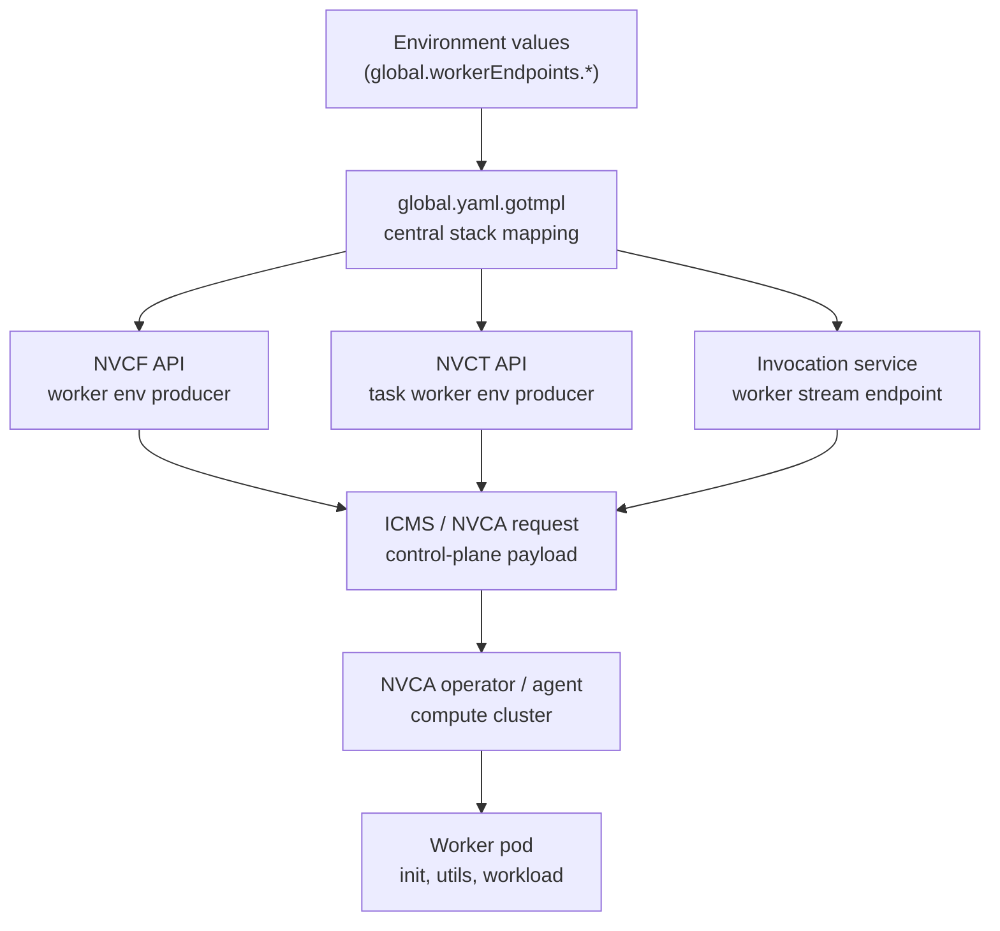
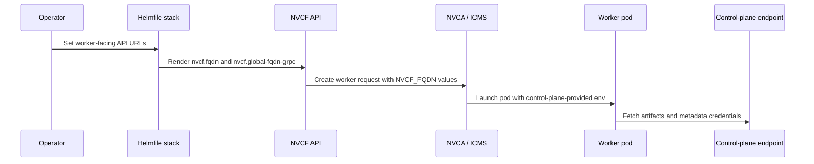
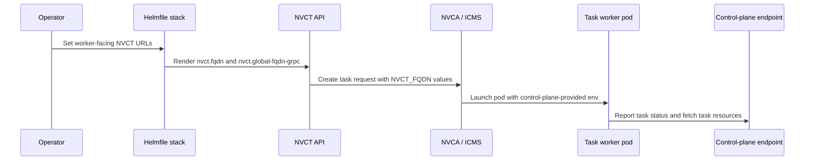

<!-- markdownlint-disable MD013 -->

# Worker Endpoint URL Flow

Self-managed NVCF supports topologies where the control plane and workers run
in different Kubernetes clusters. In those topologies, workload pods must use
control-plane URLs that are reachable from the worker cluster. They must not
derive control-plane URLs from local cluster DNS.

The stack therefore treats worker-facing control-plane URLs as configuration
owned by the control plane. The operator provides the URL once in the stack
environment, Helmfile passes it to the upstream service that owns the API, and
that service advertises the URL to workers when it launches work.

## Design Rule

Worker-facing URLs flow downstream from the control plane:

1. The environment sets a value under `global.workerEndpoints`.
2. `global.yaml.gotmpl` maps that value into the owning upstream service.
3. The upstream service uses that value in the request or pod environment it
   sends to the worker layer.
4. The worker pod receives the URL from the control-plane payload.

Worker pods should not invent these URLs locally. A local in-cluster service
name such as `api.nvcf.svc.cluster.local` is valid only when the worker runs in
the same cluster and DNS domain as that service.

## Configuration Flow



The important ownership boundary is between the control plane and the worker
cluster. The worker receives already-resolved service URLs from the control
plane. It does not choose a local DNS name for a remote control-plane service.

## Endpoint Inventory

These are the worker-facing endpoint values this stack can configure today.

| Stack value | Owning service mapping | Worker-visible endpoint |
| --- | --- | --- |
| `global.workerEndpoints.nvcfServiceURL` | `api.env.NVCF_FQDN` -> `nvcf.fqdn` | `NVCF_FQDN` |
| `global.workerEndpoints.nvcfGrpcServiceURL` | `api.env.NVCF_GLOBAL_FQDN_GRPC` -> `nvcf.global-fqdn-grpc` | `NVCF_FQDN_GRPC` |
| `grpcproxy.nvcfGrpcServiceURL` | `grpcproxy.env.NVCF_FQDN_GRPC`; defaults to `global.workerEndpoints.nvcfGrpcServiceURL` | gRPC proxy upstream API target |
| `global.workerEndpoints.nvcfNatsServiceURL` | `api.env.NVCF_NATS_WORKER_URL` -> `nvcf.nats.worker-url`; `grpcproxy.env.NATS_FQDN` | `NVCF_FQDN_NATS`; gRPC proxy NATS target |
| `global.workerEndpoints.essServiceURL` | `api.env.NVCF_ESS_BASE_URL` -> `nvcf.ess.base-url`; `api.env.NVCF_ESS_WORKER_BASE_URL` compatibility alias; `nvctApi.env.NVCT_ESS_BASE_URL` -> `nvct.ess.base-url` | `ESS_FQDN` for NVCF workers; NVCT ESS dependency |
| `global.workerEndpoints.nvctServiceURL` | `nvctApi.env.NVCT_FQDN` -> `nvct.fqdn` | `NVCT_FQDN` for NVCT task workers |
| `global.workerEndpoints.nvctGrpcServiceURL` | `nvctApi.env.NVCT_GLOBAL_FQDN_GRPC` -> `nvct.global-fqdn-grpc` | `NVCT_FQDN_GRPC` for NVCT task workers |
| `global.workerEndpoints.invocationServiceURL` | `invocation.env.WORKER_STREAM_PROPERTIES__SELF_ADDRESS` | Invocation worker stream address |
| `global.workerEndpoints.grpcProxyWorkerConnectURL` | `grpcproxy.workerConnectBaseURL` -> `SELF_WORKER_FQDN` | gRPC proxy worker CONNECT callback endpoint |
| `global.observability.tracing.*` | `api.env.MANAGEMENT_OTLP_TRACING_ENDPOINT` -> `management.otlp.tracing.endpoint` | `OTEL_EXPORTER_OTLP_ENDPOINT` |

`environments/base.yaml` keeps these values empty so service defaults continue
to work for single-cluster installs. Environment files set them when workers
need an explicit control-plane URL.

Example:

```yaml
global:
  workerEndpoints:
    nvcfServiceURL: http://api.nvcf.svc.cluster.local:8080
    nvcfGrpcServiceURL: http://api.nvcf.svc.cluster.local:9090
    nvcfNatsServiceURL: nats://nats.nats-system.svc.cluster.local:4222
    essServiceURL: http://ess-api.ess.svc.cluster.local:8080
    nvctServiceURL: http://nvct-api.nvcf.svc.cluster.local:8080
    nvctGrpcServiceURL: http://nvct-api.nvcf.svc.cluster.local:9090
    invocationServiceURL: http://invocation.nvcf.svc.cluster.local:8080
    grpcProxyWorkerConnectURL: http://grpc-proxy.nvcf.svc.cluster.local:10086
```

For a split control-plane / compute-plane deployment, use endpoints that the
compute cluster can actually route to, such as a Gateway or load balancer URL,
instead of a control-plane-only Kubernetes service DNS name.

The gRPC proxy runs in the control-plane cluster. When the worker-facing NVCF
API gRPC endpoint traverses an authenticated external Gateway, set
`grpcproxy.nvcfGrpcServiceURL` to the control-plane-local API gRPC service so
proxy health checks and API calls do not leave and re-enter the cluster.

## NVCF API Flow

NVCF API worker endpoints should follow the same contract as ESS:

| Stack intent | Upstream API config | Worker pod env |
| --- | --- | --- |
| Worker-facing NVCF API HTTP URL | `nvcf.fqdn` via `NVCF_FQDN` | `NVCF_FQDN` |
| Worker-facing NVCF API gRPC URL | `nvcf.global-fqdn-grpc` via `NVCF_GLOBAL_FQDN_GRPC` | `NVCF_FQDN_GRPC` |
| Worker-facing NATS URL | `nvcf.nats.worker-url` via `NVCF_NATS_WORKER_URL` | `NVCF_FQDN_NATS` |
| Worker-facing ESS URL | `nvcf.ess.base-url` via `NVCF_ESS_BASE_URL`; `NVCF_ESS_WORKER_BASE_URL` compatibility alias | `ESS_FQDN` |
| Worker-facing OTLP URL | `management.otlp.tracing.endpoint` via `MANAGEMENT_OTLP_TRACING_ENDPOINT` | `OTEL_EXPORTER_OTLP_ENDPOINT` |

The API service owns these worker environment values. The stack should pass
routable endpoint values into the API service configuration, and the API should
advertise them to workers. Do not configure these through
`nvcaOperator.selfManaged.*Override`; those settings are for NVCA operator and
agent connectivity back to the control plane, not for URLs injected into
workload pods.

`nvcfGrpcServiceURL` must point at a routable NVCF API gRPC endpoint. The
client-facing `ingress.gatewayApi.routes.grpc` route is for the gRPC proxy
invocation path, not the NVCF API gRPC service on port 9090. In split-cluster
installs, provision the API gRPC endpoint with an appropriate Gateway or load
balancer and set `global.workerEndpoints.nvcfGrpcServiceURL` to that address.

Enable the API GRPCRoutes with
`ingress.gatewayApi.routes.nvcfApi.grpc.enabled` and
`ingress.gatewayApi.routes.nvctApi.grpc.enabled`. When an API exposes REST and
gRPC through the same Gateway listener, configure distinct gRPC hostnames with
the corresponding `grpc.hostnames` lists. If the hostname lists are empty, the
stack defaults to `api-grpc.<global.domain>` for NVCF API and
`tasks-grpc.<global.domain>` for NVCT API. Reusing the REST hostname creates an
HTTPRoute and GRPCRoute conflict for the same listener and hostname.



This keeps function and task behavior consistent across local, single-cluster,
and split-cluster installs. The only environment-specific difference is the URL
value supplied by the stack.

## NVCT API Flow

NVCT API uses the same control-plane-owned pattern for task workers:

| Stack intent | Upstream API config | Worker pod env |
| --- | --- | --- |
| Worker-facing NVCT API HTTP URL | `nvct.fqdn` via `NVCT_FQDN` | `NVCT_FQDN` |
| Worker-facing NVCT API gRPC URL | `nvct.global-fqdn-grpc` via `NVCT_GLOBAL_FQDN_GRPC` | `NVCT_FQDN_GRPC` |
| Worker-facing ESS URL | `nvct.ess.base-url` via `NVCT_ESS_BASE_URL`; `NVCT_ESS_WORKER_BASE_URL` compatibility alias | ESS sidecar/task worker dependency |

The NVCT API reads `nvct.fqdn` and `nvct.global-fqdn-grpc`, then includes
`NVCT_FQDN` and `NVCT_FQDN_GRPC` in the ICMS launch environment for task
workers. The stack maps `global.workerEndpoints.nvctServiceURL` and
`global.workerEndpoints.nvctGrpcServiceURL` into the NVCT API pod so NVCT task
workers use the same control-plane advertised URLs as the rest of the worker
fleet.



## gRPC Proxy Flow

The gRPC proxy has two worker-relevant endpoints:

| Stack intent | Proxy config | Result |
| --- | --- | --- |
| Proxy calls NVCF API gRPC endpoint | `NVCF_FQDN_GRPC` | Proxy can request and route stateful workers through the configured API URL |
| Proxy publishes its worker CONNECT endpoint | `SELF_WORKER_FQDN` | Workers connect back to the proxy endpoint supplied by the control plane |

`NATS_FQDN` is configured from `global.workerEndpoints.nvcfNatsServiceURL` so
the proxy and NVCF API agree on the NATS endpoint used for worker coordination.

`grpcproxy.nvcfGrpcServiceURL` controls the proxy's NVCF API target. It defaults
to `global.workerEndpoints.nvcfGrpcServiceURL` for backward compatibility. In a
split-cluster deployment, set it to the control-plane-local API gRPC service
when remote workers use an authenticated external Gateway endpoint.

For split or multi-cluster installs, `ingress.gatewayApi.routes.grpcWorker`
can also render the optional gRPC worker callback `TCPRoute`. Keep this route
disabled unless worker pods need a load-balancer path back to `grpc-proxy`.
When it is enabled, run a single `grpc-proxy` replica with HPA disabled; shared
TCPRoute callback routing is not pod-affine.

## Adding New Worker-Facing URLs

When a new control-plane service needs to advertise a URL to workers, keep
parity with the existing pattern:

1. Add a named value under `global.workerEndpoints`.
2. Leave the base value empty unless a safe global default exists.
3. Set environment-specific values only where workers need a routable override.
4. Map the value into the owning upstream service in `global.yaml.gotmpl`.
5. Let the upstream service inject or advertise the URL to launched workers.
6. Document the stack value, upstream config key, and worker-visible value in
   this page.

## Verification

Before shipping a new worker endpoint value, render the stack and inspect both
the upstream service config and a launched worker pod.

```bash
make template HELMFILE_ENV=<env>
```

Check the rendered upstream service config for the expected environment or
remote-config value. After a workload is launched, confirm the worker pod env
contains the control-plane-provided URL and that the worker can reach it from
the compute cluster.
